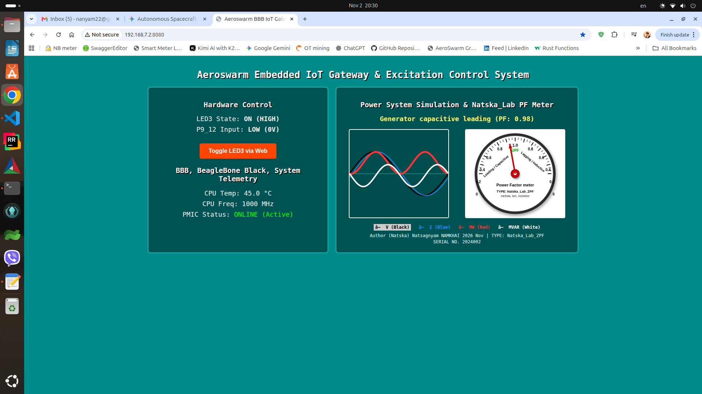

# Aeroswarm BBB IoT Gateway & Excitation Control System

Embedded Linux IoT gateway and excitation control dashboard running on BeagleBone Black (`192.168.7.2:8080`).

## Features
- **Hardware Control & Telemetry**: Web-based control for LED3 (`USR3`) and physical input monitoring for pin `P9_12` (GPIO 60), paired with real-time CPU temperature and frequency telemetry.
- **Power System Simulation & ZPF Meter**: Real-time 50Hz waveform plotting for Voltage ($V$, black), Current ($I$, blue), Active Power ($\text{MW} = V \times I$, red, fat), and Reactive Power ($\text{MVAR} = V \times I_2$, white).
- **3D Natska_Lab PF Meter**: Animated analog Power Factor meter featuring a 3D bevel effect, green **UPF** center label, arrowhead needle calibrated to 0 at $\pm 90^\circ$ phase shifts, and custom metadata (`TYPE: Natska_Lab_ZPF`, `SERIAL NO. 2024002`).

---

## Build Instructions

1. Clone or navigate to the project directory on your BeagleBone:
bash
cd ~/aeroswarm-bbb-iot-gateway-telemetry-control

2. Create a build directory and compile using CMake:
bash
mkdir -p build && cd build
cmake ..
make

---

## Test & Verification Instructions

### 1. Running the Server
Launch the compiled binary with root privileges (required for GPIO and memory-mapped hardware access):
bash
sudo ./iot_gateway_server

*Expected Output:* `Aeroswarm IoT Gateway & Natska PF Meter active on port 8080...`

### 2. Accessing the Web Dashboard
Open your laptop browser and navigate to:
text
http://192.168.7.2:8080

### 3. Testing API Endpoints via `curl`
* **Check System Status (JSON):**
bash
curl -s http://192.168.7.2:8080/api/status

* **Test LED3 Toggle (POST with Bearer Token):**
bash
curl -X POST http://192.168.7.2:8080/api/relay 

-H "Authorization: Bearer Natska2026" 

-H "Content-Type: application/json" 

-d '{"action":"toggle"}'

---
**Author:** (Natska) Natsagnyam NAMKHAI (2026 Nov)
